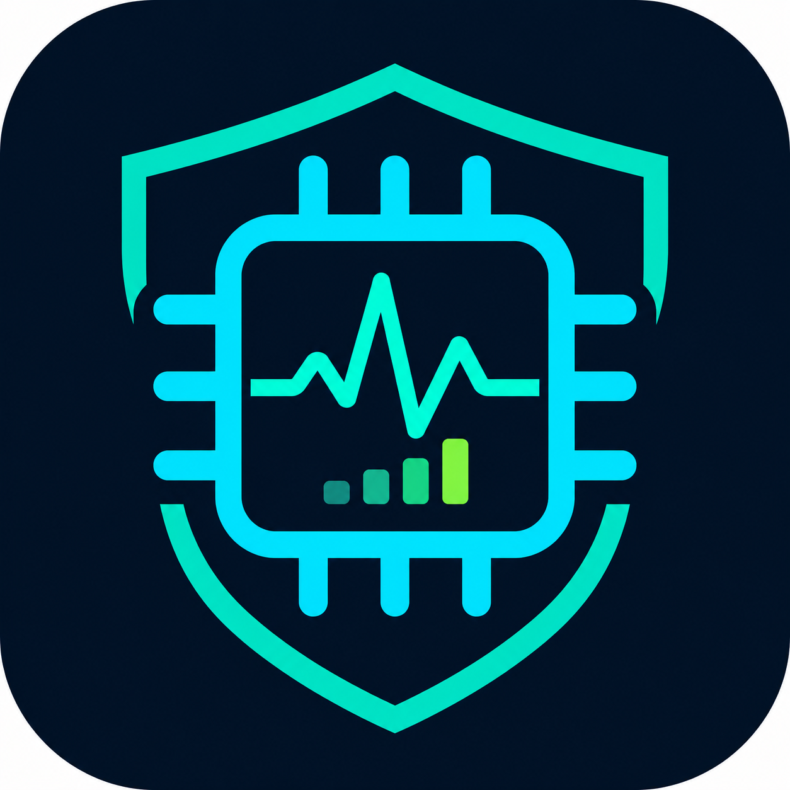
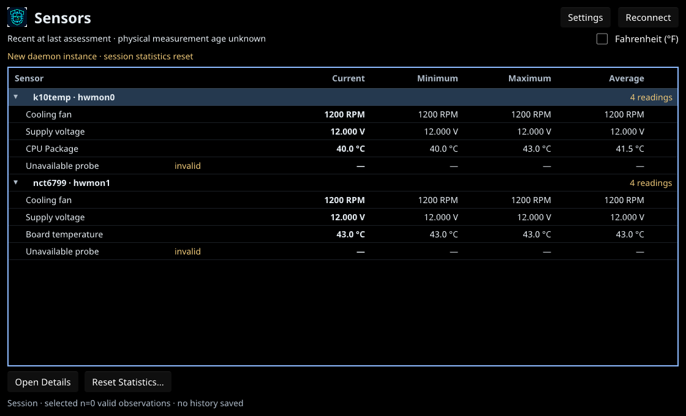

<p align="center">
  
</p>

# SiliconWatch

SiliconWatch is an experimental Linux hardware monitor built in Rust. It has a native desktop GUI and a CLI for headless monitoring.

It reads temperatures, voltages and fan speeds exposed by Linux drivers. It marks unavailable or questionable readings and leaves hardware settings unchanged.

The dense sensor view takes inspiration from HWiNFO64 and offers familiar, detailed monitoring on Linux. A separate foreground daemon collects readings. The GUI reads the daemon's cache through a local read-only API.

**Status: Alpha 1 candidate, Prototype 010.** Chris has conditionally authorized experimental external alpha testing after the verification and publication gates pass. Some qualification checks remain incomplete. This software provides experimental, read-only monitoring. It is not ready for production use or safety-critical hardware protection.

**Public alpha download coming soon.** The intended version is `v0.1.0-alpha.1`. No public alpha download is available yet. Follow the [GitHub repository](https://github.com/lgraak/Siliconwatch) and [project website](https://siliconwatch.cgillett.com/) for updates.



*The running native OLED Black GUI with demonstration fixture readings. This is an application capture, not a design mockup. It makes no claim about a particular machine's sensors.*

## Implemented in the Alpha 1 candidate

### Native desktop GUI

The Slint GUI uses the OLED Black theme by default. Dark and Light themes are also available. It groups providers and devices in a compact hierarchy and supports keyboard navigation. You can configure fonts, row density and columns.

### Sensor readings

SiliconWatch reads CPU/GPU temperatures where Linux exposes them, NVMe and other available hwmon temperatures, voltage inputs and fan RPM. Coverage depends on the machine and its drivers.

### Session statistics

Current, Minimum, Maximum and Average use distinct valid observations received by the GUI. These statistics cover the current session. They are not time-weighted and do not provide persistent history. Repeated cache reads, redraws and unit changes do not add samples.

### Device Details

The reusable native Device Details window shows the selected source's available readings, raw and canonical values, identity evidence, diagnostics and observation timing. Unsupported, failed, stale and historical states remain visible.

### CLI and foreground daemon

CLI and daemon options include one-shot tables or JSON, bounded sampling and cooperative shutdown. An opt-in Unix-socket API provides `get_info` and `get_snapshot` for the current user. Refreshing the GUI does not trigger another hardware scan.

### Desktop integration and preferences

The GUI has a StatusNotifier-compatible tray and versioned TOML settings for appearance and layout. You can review settings before importing or exporting them. Celsius/Fahrenheit preferences change the display only. Raw readings remain intact.

**Minimize to Tray** is off by default. Closing **Sensors** exits the GUI. If you enable the preference, the same session keeps running while a usable tray host is available. **Quit** always exits the GUI and leaves the separately started daemon running.

<a id="try-the-prototype"></a>

## Build and run from source

The GUI commands require a **Prototype 010 candidate checkout containing `gui/`**. Check the checkout and release status before using them. These source instructions do not mean an alpha release or installer is available.

Use Linux with the Rust 1.85.0 toolchain installed. The GUI also needs a working desktop, OpenGL, and the platform graphics and font libraries for its native backend. Distribution-specific prerequisites are not installed automatically.

Slint and slint-build remain pinned to 1.13.1. Rust 1.85 compatibility uses the documented [fontdue 0.9.5 local patch](vendor/fontdue-0.9.5-PATCH.md).

From the candidate repository root, build the CLI/daemon and GUI:

```sh
cargo +1.85.0 build --locked --release --workspace
```

For a headless-only build:

```sh
cargo +1.85.0 build --locked --release -p siliconwatch
```

### CLI readings

Run these commands as your normal user. CLI acquisition is independent of the daemon. For shared monitoring, use the daemon and GUI workflow below.

List currently exposed sensors or emit a JSON snapshot:

```sh
cargo +1.85.0 run --locked --release -p siliconwatch -- sensors
cargo +1.85.0 run --locked --release -p siliconwatch -- sensors --json
```

Take five acquisition attempts with JSON-lines output:

```sh
cargo +1.85.0 run --locked --release -p siliconwatch -- sample --count 5 --interval-ms 1000 --json-lines
```

Sampling exit 0 means the requested attempts completed. Individual attempts can still contain recoverable errors, so inspect each record. See [sampling behavior and limitations](docs/milestones/003-bounded-foreground-sampling.md) and [best-effort source identities](docs/milestones/002-stable-sensor-identity.md).

### Foreground daemon and local API

Use one daemon instance and run it as your non-root user. Do not use `sudo`.

For headless acquisition without an API listener:

```sh
cargo +1.85.0 run --locked --release -p siliconwatch -- daemon --interval-ms 1000 --stale-after-ms 3000
```

To connect the GUI, start the daemon **with `--local-api` instead**:

```sh
cargo +1.85.0 run --locked --release -p siliconwatch -- daemon --interval-ms 1000 --stale-after-ms 3000 --local-api
```

The daemon stays in the foreground and writes lifecycle notices to stderr. Ctrl-C or SIGTERM requests cooperative shutdown. Blocked drivers or output can delay completion. No service is installed. See the [daemon lifecycle report](docs/milestones/008-headless-daemon-lifecycle.md).

The API listens at `$XDG_RUNTIME_DIR/siliconwatch/api.sock`. The runtime directory must already exist, be private and belong to your non-root user. The daemon checks directory permissions and peer identity. Neither the daemon nor the GUI bypasses permissions, takes over another instance or automatically repairs stale endpoints.

The API exposes only `get_info` and `get_snapshot`. The `get_snapshot` request reads the existing cache without scanning hardware. The API uses a versioned JSON protocol over a local Unix socket. It is not an HTTP service. See the [API contract and client example](docs/api/local-v1.md) and [Prototype 009 report](docs/milestones/009-local-readonly-api.md).

### Launch the GUI

With the API-enabled daemon running, use another terminal:

```sh
cargo +1.85.0 run --locked --release -p siliconwatch-gui -- --refresh-ms 1000
```

The GUI connects automatically to the current user's socket. **Reconnect** retries under the same permission checks and rate limits. It never requests a hardware scan.

For a slower daemon acquisition interval, choose a GUI refresh interval at least as long. GUI refresh accepts 1000 to 60000 milliseconds and defaults to 1000.

To view a sensor's details, double-click it, select it and press Enter, or choose **Open Details**. See the [GUI guide](docs/GUI.md) for keyboard controls, tray behavior, freshness labels, display preferences and recovery.

## Import and export appearance settings

Import and export are GUI actions. They are not CLI subcommands.

1. Open **Settings → Import, Export & Recovery**.
2. Enter a full absolute file path. There is no native file picker in this candidate.
3. Choose **Export Settings…** or **Import Settings…**.
4. Review the preview, then confirm or cancel.

For an appearance-only profile, leave **Include device group preferences in export** off. Optional device-group selectors can reveal source topology and require review when imported. Profiles do not contain sensor history, session statistics, credentials, API access policy or hardware controls.

The GUI stores settings at `$XDG_CONFIG_HOME/siliconwatch/config.toml`, falling back to `~/.config/siliconwatch/config.toml`. It leaves invalid files untouched and reports recovery or unsaved state. Importing appearance preferences does not reset session statistics or change daemon behavior. See the [GUI guide](docs/GUI.md#portable-settings) for full import, export, backup and recovery steps.

## Hardware compatibility

SiliconWatch reads measurements exposed by Linux monitoring drivers. Available readings depend on hardware, firmware and kernel-driver support. A familiar source name does not prove a physical component's identity. Missing fan RPM can mean missing driver support rather than an application defect.

Some Super I/O monitoring chips need additional drivers. SiliconWatch **does not install or load kernel modules**. Third-party modules can add requirements for kernel-version compatibility, signatures, trust and ongoing maintenance. A configuration that works on one machine is not a universal recommendation.

On a tested GMKtec EVO-X1 with an IT8613E monitoring chip, fan RPM became available through an already-installed `it87` driver. Linux exposed the channels, and SiliconWatch reported `fan2_input` and `fan3_input` without scaling or invented CPU/System labels.

That result applies to the tested host. It does not provide independent RPM calibration, verify physical fan mapping or guarantee compatibility with future kernels or reboots.

SiliconWatch does not load modules, force device IDs or change firmware. Report missing or questionable readings through [GitHub Issues](https://github.com/lgraak/Siliconwatch/issues). Omit private machine identifiers and raw captures unless you have reviewed what they reveal.

## Native package candidates

Native `.deb`, `.rpm` and `.pkg.tar.zst` candidates were prepared with Rust 1.85 in Debian 12, Fedora 44 and Arch build environments. Installation, fixture/API checks and removal were tested on Debian 12, Ubuntu 24.04, Fedora 44 and the recorded Arch rolling image.

The Debian GUI requires glibc 2.35. Fedora/Arch builds require 2.43. Tests on these base distributions do not establish package installation on Linux Mint, CachyOS or EndeavourOS.

See the [installation guide](packaging/linux/INSTALL.md) and [package preparation report](docs/milestones/010-multidistro-package-preparation.md) for exact versions, dependencies, hashes and desktop qualification limits. Installation does not start a daemon, enable a service or configure a driver. The packages remain unsigned candidates until release publication receives separate approval. No portable AppImage is claimed.

## Known limitations

- This alpha provides **read-only monitoring**. It has no hardware controls, protective shutdown, alarms or calibration. Sensor coverage is not guaranteed.
- Statistics cover the current session only. A recent response does not make stale or historical readings current. Physical measurement age and hardware health are not certified.
- Production launch and tray checks passed on the current KDE Wayland and XWayland host. Fresh instrumented Wayland full-workflow and lifecycle probes timed out while waiting for initial snapshots. The cause remains unresolved.
- XWayland full workflow, profile restarts and lifecycle checks passed. These results do not establish behavior in other distributions' actual desktop sessions.
- Checks remain open for a separate Xorg session, GNOME, mixed-monitor behavior and physical tray interaction. Complete human keyboard and screen-reader qualification also remains open.
- Numerical CPU/RSS/latency targets are not fully qualified. There is no universal Linux binary-portability claim or publicly released AppImage.

The [Prototype 010 implementation report](docs/milestones/010-native-gui.md) records the checks that ran and their limitations. The [approved proposal](docs/milestones/010-native-gui-proposal.md) is a historical planning record. Later implementation approvals govern the working candidate.

## Future direction

Planned features include:

- Graphs and persistent history
- Configurable dashboards
- Calculated sensors
- Broader hardware providers
- Portable diagnostic reports
- Remote monitoring
- Alarms and protective actions

These are future plans, not current Alpha 1 features. See the [design decisions](docs/DESIGN_DECISIONS.md) for details. This documentation update does not imply a subsequent prototype or deployment.

## Help shape SiliconWatch

You can help with Rust, Linux hardware interfaces, native desktop applications or testing across different systems. [Open an issue](https://github.com/lgraak/Siliconwatch/issues) to share a use case, discuss hardware support, report a bug or propose an area to work on.

Contributions follow the [DCO signoff policy in Decision 41](docs/DESIGN_DECISIONS.md#41-contributor-provenance--accepted). Contributors retain their copyright; no CLA or copyright assignment is required.

## Acknowledgments

SiliconWatch takes inspiration in part from [HWiNFO64](https://www.hwinfo.com/), developed by Martin Malík of REALiX.

HWiNFO64 sets a high standard for comprehensive hardware monitoring, sensor accuracy and system diagnostics. Its depth of information and attention to detail helped shape SiliconWatch.

We appreciate Martin's years of work on HWiNFO and its value to hardware enthusiasts and engineers.

SiliconWatch is an independent, open-source project that aims to bring similarly comprehensive monitoring to Linux.

**SiliconWatch is not affiliated with, endorsed by, or derived from HWiNFO64 or REALiX.**

## License

SiliconWatch is licensed under the [GNU General Public License v3.0](https://github.com/lgraak/Siliconwatch/blob/main/LICENSE).
