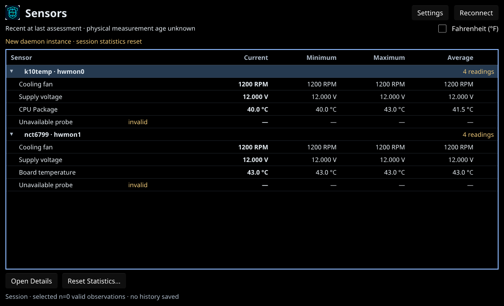
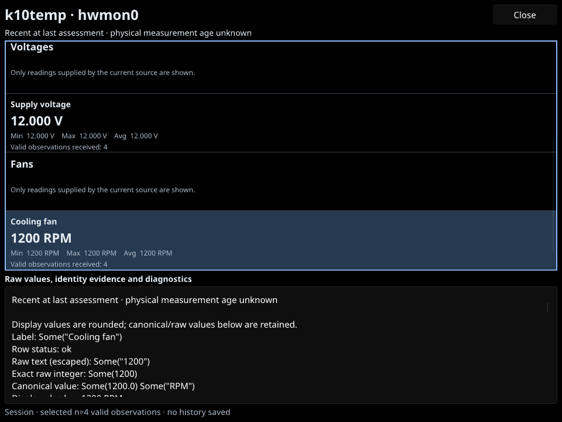
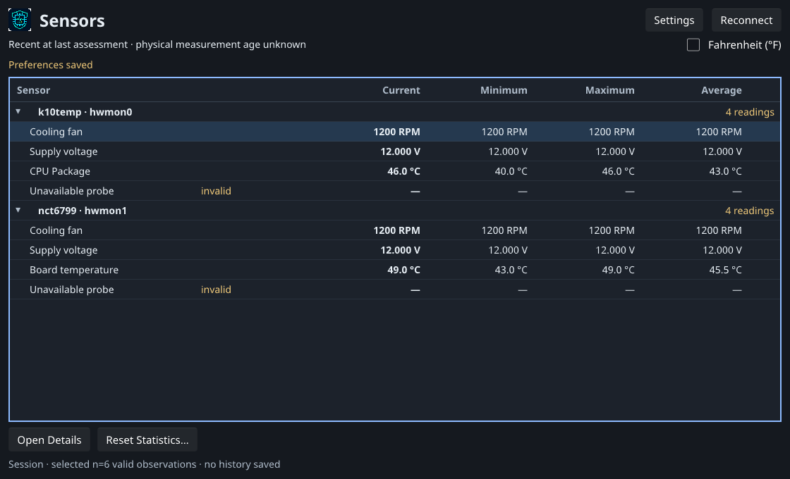
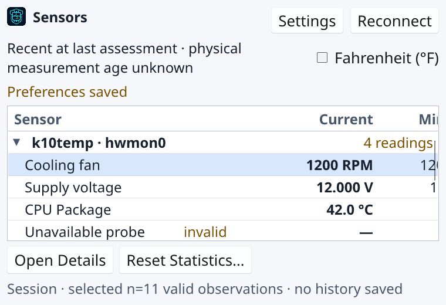
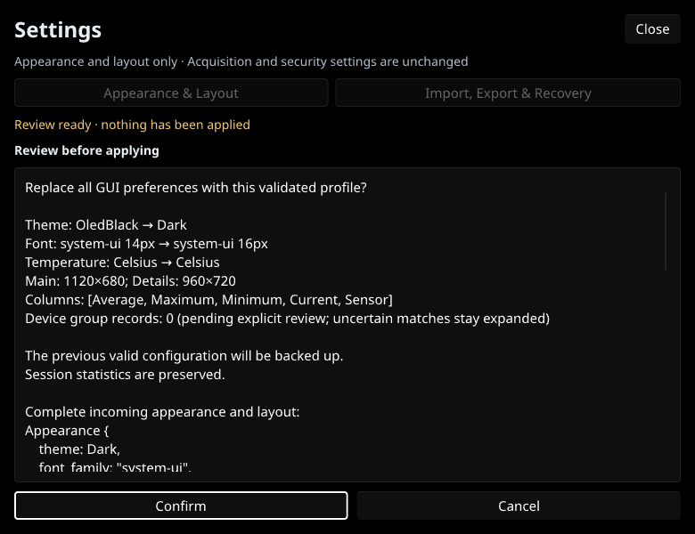
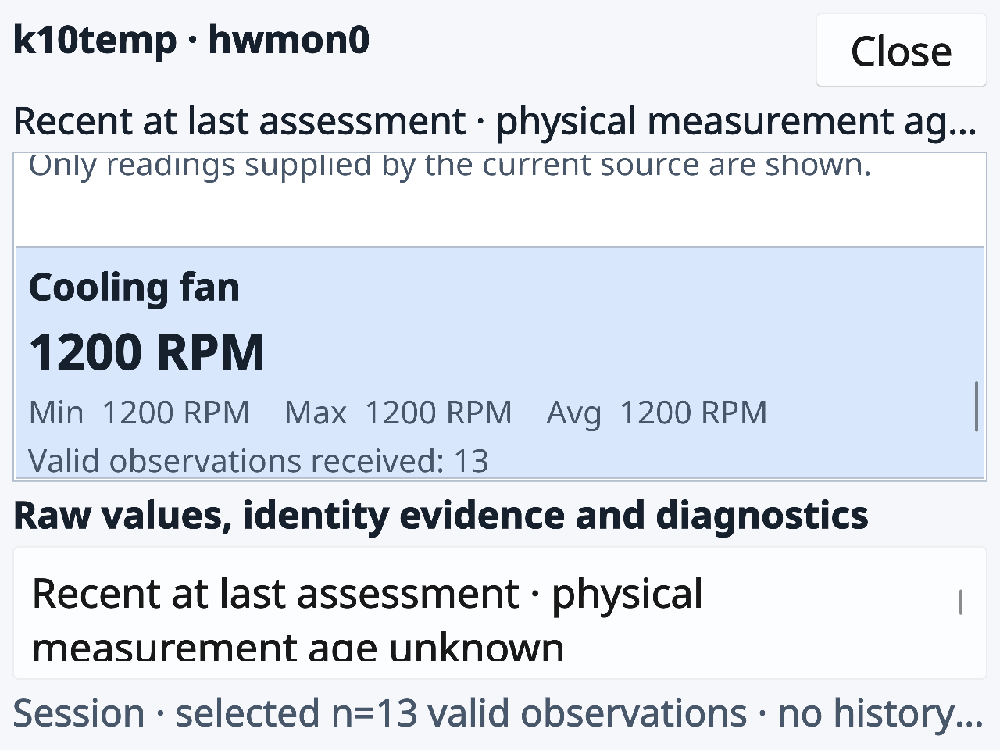

> Current status: implementation complete; final qualification **Partial**; technical acceptance **Pending**. The dated system-tray update below is the latest record. Earlier implementation evidence remains preserved.

# Prototype 010 — Native GUI implementation and compatibility verification

**Review update: 2026-11-17. Completion status: Partial qualification; implementation and available local checks completed. Technical acceptance: Pending Chris's review.**

## 1. Milestone summary

Chris authorized the native GUI and local verification, then explicitly approved the narrow fontdue 0.9.5 compatibility patch needed by Rust 1.85. The compatibility gate passed before GUI implementation resumed. The existing scaffold was continued in place. No daemon implementation, local API protocol, accepted sensor semantics, historical milestone, or approved proposal was rewritten.

The implementation provides a native Slint Sensors window, one reusable Device Details window, and Settings. OLED Black is the default; Dark and Light are alternatives. The previously blocked report is preserved externally at `/tmp/siliconwatch010-resume-t7keeha7/blocked-report-before.md`, and the prior attempt's evidence remains in `/tmp/siliconwatch010-implementation-s324vahm/`.

This report distinguishes implemented functionality, executed tests, failures fixed during development, and outstanding qualification. It does not confer technical acceptance, publication authority, or permission to begin Prototype 011.

## 2. Implementation details

| Area | Implemented behavior |
| --- | --- |
| Native table | Hierarchical source-device groups; Sensor, Current, Minimum, Maximum and Average; right-aligned values; virtualized rows, horizontal scrolling, disclosure and preserved source-aware selection. No label-based physical-device merging. |
| Project icon | The user-supplied icon file exactly matches the existing `assets/branding/siliconwatch-icon.png` (1254×1254, SHA-256 `e987efdaf116348e7c2dbc89496a28bfc3336a65763409939bd3d5844f49be59`). The unchanged artwork is embedded in all three window icon properties and displayed beside Sensors. No image substitution, editing, icon installation or deployment occurred. |
| Appearance | Pure-black default main/table/details surfaces, conventional Dark and Light, visible focus/selection, optional separators/alternate rows, compact/comfortable density, installed font family and 10–24 logical pixel sizes. Missing fonts show a fallback notice while preserving the requested family. |
| Statistics | Bounded session-only count/min/max/arithmetic mean of distinct eligible observation publications. Cached polls, redraws, unit changes and Details do not add samples. Invalid/noncurrent observations freeze aggregates; new daemon epochs and changed/ambiguous identities cannot inherit old statistics. Reset preserves the publication watermark. |
| State | Distinct waiting, successful empty, recent-at-assessment, stale, unconfirmed, historical, failed, stopped, disconnected and row-quality indications. Physical measurement age remains unknown. Conservative request-latency age accounting and detected local clock/suspend anomalies prevent positive currentness claims. |
| Device Details | All rows from the selected source registration; only observed temperature/voltage/fan categories; unsupported rows retained; shared statistics; selectable raw/canonical values, source/identity evidence, diagnostics and observation metadata. No invented CPU/GPU capability inventory. |
| API client | Only `get_info` and `get_snapshot`; strict bounded JSON validation, version/epoch checks, non-root same-user namespace/peer checks, one cancellable worker, one in-flight request, bounded latest-result mailbox, sequential refresh/backoff/reconnect. Opening windows and changing preferences do not acquire hardware. |
| Preferences | Version-1 portable TOML; strict size/depth/type/range/version/unknown-field validation; appearance, units, geometry, column order/widths and group records. No credentials, endpoint/security/acquisition policy, hardware controls or statistics. |
| Transactions | Worker-based import/preview/confirm/cancel, immutable export preview with destination recheck, atomic same-directory replacement, previous-valid-byte backup, fingerprint conflict rejection, explicit original-preserving recovery. Replacement and reload fences prevent stale queued autosaves from overwriting a reviewed profile or external edit. |
| Portable groups | Saved/imported records stay pending. Review requires a recent live inventory, unique consistent identity anchors and commit-time source revalidation. Missing/ambiguous/conflicting matches remain expanded/inactive. Direct toggles without suitable anchors remain session-only. |
| Keyboard | Table arrows/Home/End/Page navigation, Left/Right disclosure, Enter/Space, Details Escape/focus return, Settings navigation and confirmation via Enter. Accessible list/row labels describe values, units, quality and count. Screen-reader qualification is separate below. |

The normal entry point is `cargo +1.85.0 run --locked -p siliconwatch-gui`; start the daemon separately with `--local-api`. `--refresh-ms` defaults to 1000 and accepts one canonical decimal value in 1000–60000. The [GUI guide](../GUI.md) documents operation, import/export and recovery.

The product uses event-driven API updates and a single expiry timer, plus a one-second local clock anomaly check. Configuration completion is polled only while a bounded job is active. It does not continuously repaint at 60 Hz or retain measurement history. These structural properties are not a measured performance-budget claim.

Important files are `gui/src/app.rs`, `client.rs` and `client/os.rs`, `protocol.rs`, `model.rs` and `model/clock.rs`, `statistics.rs`, `presentation.rs`, `preferences.rs`, the Slint files under `gui/ui/`, and their deterministic tests. `gui/src/bin/native_check.rs` is an opt-in verification executable, excluded from ordinary GUI builds unless `ui-verification` is enabled.

### Dependency compatibility gate and exact vendor diff

Slint and slint-build remain exactly **1.13.1**, the approved runtime features remain `std`, `backend-winit`, `renderer-femtovg`, `accessibility`, `compat-1-2`, and the declared MSRV remains **1.85**. No fontdue downgrade or alternate font parser was used.

Cargo's root `[patch.crates-io]` selects `vendor/fontdue-0.9.5`; the package is excluded from workspace membership. The complete 43-file crates.io package is retained. Exactly one source file differs from upstream: six same-width unsigned-to-signed conversions. All other 42 files—including parser soundness validation, upstream lockfile, manifests, copyright notices and all MIT/Apache-2.0/Zlib license files—are byte-identical.

Archive SHA-256: `e796cb6894e6418daacea84b28dd4f98d3b32c74d5bb452ba1ecfbf5ad8e84ca`. Packaged VCS revision: `1a84e6d31ad8f91be74a2d446a8e966e2bf4ba88`. Provenance and licensing are recorded in [the vendor notice](../../vendor/fontdue-0.9.5-PATCH.md); [the complete unified diff](../../vendor/fontdue-0.9.5-rust185.patch) is the exact approved patch. Its replacements, in upstream line order 40/46/52/167/172/177, are:

```diff
- Some(u8::cast_signed(self.0.get(index)?))
+ Some(self.0.get(index)? as i8)
- Some(u16::cast_signed(self.0.get(index)?))
+ Some(self.0.get(index)? as i16)
- Some(u32::cast_signed(self.0.get(index)?))
+ Some(self.0.get(index)? as i32)
- Some(u8::cast_signed(self.read_u8()?))
+ Some(self.read_u8()? as i8)
- Some(u16::cast_signed(self.read_u16()?))
+ Some(self.read_u16()? as i16)
- Some(u32::cast_signed(self.read_u32()?))
+ Some(self.read_u32()? as i32)
```

These preserve same-width bit interpretation and all existing parsing/bounds behavior. `src/font.rs` remains identical and retains `char::from_u32` validation; the parser soundness fix is present. Final source audit again found exactly these six replacements and no extra/missing package files.

The initial patch resolution retained all 593 locked package versions and dependency edges; only fontdue's source changed from the registry to the local path. Linux metadata has 445 packages, with a 443-package GUI closure and no declared GUI dependency MSRV above 1.85. Undeclared dependency MSRVs are not assumed compatible merely from metadata: actual Rust 1.85 builds were executed.

The sole later verification dependency is optional `image = 0.25.9`, PNG-only, behind `ui-verification`, for encoding actual native framebuffer captures. It was already locked and reachable: no package, version or transitive-feature change was introduced, only the GUI's optional direct edge. Normal runtime feature selection is unchanged. TOML remains 0.8.23. The headless default workspace member remains the original CLI package.

Gate results before implementation: actual locked/offline GUI builds passed with Rust 1.85.0 and installed stable; upstream fontdue standalone tests passed 4/4 on each; a separate harness compiled the actual patched parser and passed four conversion/boundary/truncation tests on each, including all u8/u16 bit patterns and representative u32 boundaries. Graph/source checks passed. An initial root-workspace `cargo test -p fontdue` invocation hit an internal Cargo resolver panic for the build-only dependency; the unchanged excluded vendor manifest's standalone test invocation succeeded. The failed invocation log is retained and is not counted as passed.

## 3. Verification results

Canonical raw logs, commands, source/dependency audits and private test evidence are under `/tmp/siliconwatch010-resume-t7keeha7/`. Build targets are outside every repository under the Codex workspace's `work/010-build` and `work/010-build-stable` directories.

| Check | Executed result |
| --- | --- |
| Rust 1.85 formatting | `cargo +1.85.0 fmt --all --check`: PASS. |
| Rust 1.85 configured Clippy | Workspace `cargo clippy --locked -- -D warnings`: PASS; GUI all-targets with `ui-verification`: PASS. |
| Rust 1.85 tests | Original headless package: 166 tests + 2 doctests PASS on complete rerun. GUI: 83 library + 1 CLI = 84 tests PASS, zero failures/ignored. Verification binary has no unit tests; its runtime evidence is separate. |
| Rust 1.85 release | Locked/offline workspace release build: PASS for headless CLI and native GUI. |
| Installed stable | Rust 1.100.0: headless 166 + 2 doctests; GUI 84; configured workspace and GUI all-target Clippy; formatting and release builds: PASS. Final results are recorded in the verification summary. |
| Strict Python | 153/153 PASS, zero errors/failures/skips; all eight required modules and four required CLI alias tests discovered. |
| DCO checker tests | 6/6 PASS in isolated temporary Git fixtures; no contribution commit was created. |
| Native windows | Real Winit/FemtoVG windows against the actual unchanged daemon and changing private hwmon fixtures. Backend/scale/restart matrix and actual images below. |
| API/statistics/configuration | Deterministic malformed/duplicate/oversized input, time/epoch/currentness, timeout/cancel/reconnect, FIFO/path/peer checks, statistics/reset/discontinuity, import/export/recovery/conflict/failure injection and UI transaction ordering tests passed. |
| No new acquisition | Real daemon FIFO synchronization probe passed: six cached sequence-1 reads, two reconnects, unit/disclosure/Details operations, statistics count one, one admitted FIFO reader and unchanged daemon thread count. Releasing the blocked scan produced sequence 2/raw 99000. Only `get_info`/`get_snapshot` were recorded; no GUI fixture/sysfs descriptors observed. |
| Hardware smoke | One non-root read-only CLI snapshot, exit 0, approximately 0.10 seconds; details below. |

Python tests hardcode a repository-relative fixture executable and create a temporary `target/` artifact. To preserve existing ignored evidence, the unchanged scripts and DCO checker were copied to a new external test tree, hash-verified, and supplied the freshly built Rust 1.85 executable there. The CI's exact discovery requirements and no-skip rule were retained. Source and executable hashes were rechecked afterward; no repository target artifacts were changed.

The first workspace Rust test run failed the pre-existing `daemon_broken_stderr_pipe_is_a_failure_not_one_shot_success` test because its child did not terminate within ten seconds. The test passed individually, then all seven daemon CLI tests and the full headless package passed, with no backend/test edits. The original timing failure remains unexplained; it is not hidden by the rerun.

Development failures were retained and corrected: timer-time screenshots read the wrong/unrendered framebuffer, fixed by per-window AfterRendering capture before presentation; Settings confirmation focus during component construction caused a real layout recursion panic, fixed by deferred focus and retested through Enter confirmations; large-font footer/Details layout and selected-row scrolling were corrected. Synthetic Slint scale overrides differing from native DPI produced undersized captured frames after reopening windows, even after explicit physical sizing. Those runs failed sizing qualification and remain excluded. The final native-DPI runs keep the backend and toolkit scale aligned; portable sizing uses explicit logical-to-effective-physical conversion. Ineffective timing workarounds were removed. Earlier images/logs remain separate from final qualified captures.

### Native evidence and actual screenshots

All final runs used the exact icon-integrated Rust 1.85 verification executable, SHA-256 `73a19e6163118bb4605fd1a77fa993d506215c9f613016a034dc3599dd2e5ac7`, on KDE/CachyOS. `native-dpi-final-matrix.json` records paths, GUI/restart exits, fixture changes and owned-daemon cleanup.

| Backend and scale | Result |
| --- | --- |
| Native Wayland, compositor-provided scale 1 | Full probe + exact-profile restart PASS on unchanged rerun. |
| X11/XWayland, native DPI 1 | Full probe + exact-profile restart PASS. |
| X11/XWayland, native DPI 1.5 | Full probe + exact-profile restart PASS. |
| X11/XWayland, native DPI 2 | Full probe + exact-profile restart PASS. |

Slint's synthetic override was unset in these final runs. X11 used the documented per-process `WINIT_X11_SCALE_FACTOR` in [pinned Winit 0.30.13](https://raw.githubusercontent.com/rust-windowing/winit/v0.30.13/src/window.rs). Wayland used the compositor's actual scale. The final probe captures 18 scenarios per full run plus a restart image; it rejects frames below the logical minimums. Actual dimensions are logged because the compositor may constrain or retain a requested size. Main 1120×680 and 760×520, Details 960×720 and 640×480, and 10/24-pixel font scenarios were exercised; large-font minimum layouts and confirmation controls were visually inspected.

One initial native Wayland attempt stopped in phase 9 because Details was no longer visible when a capture was requested. No cause was established. The unchanged full rerun passed; both records are retained. This is separate from the excluded synthetic-override sizing failures.

The probe injects Slint window key press/release events into actual native windows. This exercises application focus/navigation and callback paths; it is not physical keyboard input or a screen-reader run. Captures are unedited framebuffer images from each window's AfterRendering notification, not browser mockups or wireframes. Fixture readings changed during the run; invalid rows remained explicit. Each successful process exit left its externally started daemon alive; the runner then stopped only that owned fixture daemon cooperatively.













## 4. Hardware validation

Executed on CachyOS Linux, kernel `7.3.4-1-cachyos`, as the existing non-root user with matching real/effective UIDs. One existing CLI `sensors --json` scan returned **11 sensors: 9 ok, 2 unsupported, no snapshot warnings**. Providers were acpitz, amdgpu, iwlwifi_1, k10temp and nvme; canonical units comprised seven Celsius rows, two voltage rows and two unsupported/unclassified rows. Examples at that instant included acpitz 20.0 °C, NVMe 43.85 °C, amdgpu 42.0 °C and k10temp 71.125 °C. These are observations, not calibration or health conclusions. No fan measurement was provided in that snapshot.

No hardware settings, fan/pump controls, driver options or service configuration changed. Raw hardware evidence remains private in the external evidence directory and is not embedded in screenshots or exported GUI profiles. This was a brief CLI hardware smoke; the detailed native matrix used deterministic fixtures, not an extended hardware benchmark.

## 5. Architecture and design review

The GUI remains an optional API client. Backend acquisition and API semantics are unchanged; read-only controls, manual daemon ownership, current-user boundaries and physical-age uncertainty remain explicit. Details and statistics reuse one model/client. Schema-1 portable identities deliberately require review rather than treating topology-derived identifiers as durable physical identities.

The proposal is unchanged byte-for-byte, SHA-256 `e1e98befd4d9045cf6d0eca3ea632ce2ec1d916881eab8dd5e7df17ebc5aa4a7`. Chris's later implementation approval superseded only its theme choices with OLED Black/Dark/Light. The approved path-entry import/export design is implemented; native file picker integration was not added. Per-sensor appearance, graphs/history, controls, remote access and physical-device relationship inference remain deferred.

No frontend-design skill was installed in the available skill locations, so no additional skill was installed. UI work used the existing approved proposal, native Slint code and actual screenshot inspection. The repository `/handoff` skill was explicitly invoked as described below.

## 6. Known issues, unexecuted checks and limits

- **Accessibility qualification remains open.** Orca was unavailable; physical keyboard-only human review and inspection of the actual AT-SPI tree were not executed. Source/generated accessibility labels and native injected-key behavior do not establish screen-reader usability or native table-cell semantics.
- **Synthetic scale override remains a known qualification failure.** Setting `SLINT_SCALE_FACTOR` differently from the native backend factor produced undersized captures after window recreation. Pinned Slint/Winit size conversion is a plausible source-level explanation, not proof that every capture represented a persistent window defect. No additional dependency patch was authorized or applied. Use native desktop DPI; X11 100/150/200% tests used Winit’s native factor with the Slint override unset.
- X11 evidence uses the available XWayland server inside KDE's Wayland session. A separate native Xorg session, other compositors/distributions, mixed-DPI monitor movement and other GPUs were not qualified. Per-process native X11 DPI factors are controlled test scenarios, not a multi-monitor certification. Per-window icon hints may also be presented differently by each compositor; the image is visible in the main GUI header.
- Initial effective window sizing is distinguished from requested portable geometry. Later compositor/work-area changes can still be interpreted as a resize by the current baseline heuristic. Explicit Settings dimensions remain the reliable portable choice. The compositor can constrain requested sizes.
- The proposal's 60-second CPU budget, 1000-row RSS target, 4096-row input-latency matrix, and exhaustive 0/1/4096-row native layout matrix were not executed. Virtualization/bounds are implemented and deterministic input limits are tested; no numerical performance-budget claim is made.
- The original headless broken-stderr timeout has no proven root cause. Subsequent targeted/full checks passed without changing it.
- Clock/suspend detection is conservative and best-effort. It cannot establish physical measurement timestamps, detect suspend before client start, or guarantee every short clock discontinuity is detected.
- Same-user malicious processes, arbitrary kernel/filesystem stalls, power-loss durability and true cross-UID isolation are not newly certified. File/peer/failure-injection fixtures cover stated application invariants, not every host threat or storage failure.

## 7. Git status, exact manifest and preservation

Final preservation comparison **PASS**, with zero unexpected differences. Branch remains `codex/alpha1-prototype010` at `3b6b85732b374d9d3dbc43ca052194475071bda9`; index diff is empty. Exactly 78 authorized changed/new files are listed below. The original checkout’s intentional modifications, Prototype 007/008/009 worktrees, historical artifacts, private evidence and earlier output files remain preserved.

The comparison reconciled five worktrees and 432 pre-existing working files, 9,418 pre-existing ignored entries, 1,550 ignored directories and 281 protected external evidence files. Of the ignored entries, 9,227 regular files were fully hashed; the original audit policy used metadata only for 179 files larger than 4 MiB, and checked 12 symlinks by metadata/target. No full-content claim is made for those 179 large files. Refs, worktree registration, HEAD/branch/index and the approved proposal hash are unchanged. No relevant build/daemon processes were visible at the audit; the coordinating agent separately verified completion of its execution sessions. The sole new ignored file is the exact upstream vendor Cargo.lock, explicitly authorized as part of the complete package and included in the manifest.

`/tmp/siliconwatch010-resume-t7keeha7/preservation-after.json` records the comparison; `final-changed-files.json` records all 78 before/after entries. The repository `/handoff` skill was explicitly invoked from `.agents/skills/handoff/SKILL.md` in the original checkout. Its continuation is `/tmp/siliconwatch010-resume-t7keeha7/CONTINUATION.md`, outside every registered worktree, with artifact references and suggested skills. Prior handoffs remain unchanged.

No staging, commits, pushes, PRs, merges, deployment, branch switches or Prototype 011 work were performed. The approved proposal remains an existing untracked file and is excluded from the new-change manifest because its content is preserved.

The following 78 paths comprise the exact working-file manifest for this continuation. The external `final-changed-files.json` records before/after metadata and SHA-256 values. The upstream vendor Cargo.lock is intentionally ignored by the unchanged upstream .gitignore; it is retained and included in this manifest, and must be explicitly included if staging is separately authorized later. It is the sole authorized new ignored file.

```text
Cargo.lock
Cargo.toml
README.md
docs/GUI.md
docs/milestones/010-native-gui.md
docs/milestones/010-native-gui/details-font24-200pct.png
docs/milestones/010-native-gui/details-oled.png
docs/milestones/010-native-gui/import-preview.png
docs/milestones/010-native-gui/main-dark.png
docs/milestones/010-native-gui/main-light-font24.png
docs/milestones/010-native-gui/main-oled.png
gui/Cargo.toml
gui/build.rs
gui/src/app.rs
gui/src/bin/native_check.rs
gui/src/client.rs
gui/src/client/os.rs
gui/src/client/tests.rs
gui/src/lib.rs
gui/src/main.rs
gui/src/model.rs
gui/src/model/clock.rs
gui/src/model/tests.rs
gui/src/preferences.rs
gui/src/preferences/tests.rs
gui/src/presentation.rs
gui/src/protocol.rs
gui/src/protocol/tests.rs
gui/src/statistics.rs
gui/ui/common.slint
gui/ui/details.slint
gui/ui/main.slint
gui/ui/settings.slint
vendor/fontdue-0.9.5-PATCH.md
vendor/fontdue-0.9.5-rust185.patch
vendor/fontdue-0.9.5/.cargo_vcs_info.json
vendor/fontdue-0.9.5/.github/workflows/build.yml
vendor/fontdue-0.9.5/.github/workflows/format.yml
vendor/fontdue-0.9.5/.gitignore
vendor/fontdue-0.9.5/CHANGELOG.md
vendor/fontdue-0.9.5/Cargo.lock
vendor/fontdue-0.9.5/Cargo.toml
vendor/fontdue-0.9.5/Cargo.toml.orig
vendor/fontdue-0.9.5/LICENSE-APACHE
vendor/fontdue-0.9.5/LICENSE-MIT
vendor/fontdue-0.9.5/LICENSE-ZLIB
vendor/fontdue-0.9.5/README.md
vendor/fontdue-0.9.5/images/layout.png
vendor/fontdue-0.9.5/images/rasterize_cff.png
vendor/fontdue-0.9.5/images/rasterize_glyf.png
vendor/fontdue-0.9.5/licenses/rust-lang/libm
vendor/fontdue-0.9.5/licenses/xi-editor/xi-unicode
vendor/fontdue-0.9.5/rustfmt.toml
vendor/fontdue-0.9.5/src/font.rs
vendor/fontdue-0.9.5/src/hash.rs
vendor/fontdue-0.9.5/src/layout.rs
vendor/fontdue-0.9.5/src/lib.rs
vendor/fontdue-0.9.5/src/math.rs
vendor/fontdue-0.9.5/src/platform/float/as_i32.rs
vendor/fontdue-0.9.5/src/platform/float/atan.rs
vendor/fontdue-0.9.5/src/platform/float/atan2.rs
vendor/fontdue-0.9.5/src/platform/float/ceil.rs
vendor/fontdue-0.9.5/src/platform/float/floor.rs
vendor/fontdue-0.9.5/src/platform/float/fract.rs
vendor/fontdue-0.9.5/src/platform/float/get_bitmap.rs
vendor/fontdue-0.9.5/src/platform/float/mod.rs
vendor/fontdue-0.9.5/src/platform/float/sqrt.rs
vendor/fontdue-0.9.5/src/platform/float/trunc.rs
vendor/fontdue-0.9.5/src/platform/mod.rs
vendor/fontdue-0.9.5/src/platform/simd_core.rs
vendor/fontdue-0.9.5/src/platform/simd_x86.rs
vendor/fontdue-0.9.5/src/raster.rs
vendor/fontdue-0.9.5/src/table/gsub.rs
vendor/fontdue-0.9.5/src/table/kern.rs
vendor/fontdue-0.9.5/src/table/mod.rs
vendor/fontdue-0.9.5/src/table/parse.rs
vendor/fontdue-0.9.5/src/unicode/mod.rs
vendor/fontdue-0.9.5/src/unicode/tables.rs
```

## 8. Recommended next authorization

Chris should review this Prototype 010 implementation, screenshots, vendor provenance and qualification limits. The next small scope is **Prototype 010 acceptance closure**: authorize only any requested fixes and the remaining physical-keyboard/Orca/AT-SPI and chosen desktop/performance qualification. Acceptance criteria are usable navigation and announcements with the selected assistive technology, reviewed visual/portable-settings behavior, no backend/API regression, and explicit disposition of remaining limits. Publication and any later milestone require separate authorization. No next milestone has begun.

## 9. HANDOFF TO CHATGPT

Chris authorized completing SiliconWatch Prototype 010 locally, including a narrowly scoped fontdue 0.9.5 compatibility patch. The patch replaces exactly six same-width `cast_signed` calls, preserves the parser soundness fix and all upstream licenses/provenance, and uses Cargo's local patch mechanism. Slint/slint-build remain 1.13.1 and MSRV remains Rust 1.85. The compatibility gate passed before GUI implementation resumed.

Your supplied artwork is now embedded as each window’s icon and shown in the Sensors header. The native GUI provides the OLED Black default, Dark and Light alternatives, a hierarchical Sensor/Current/Minimum/Maximum/Average table, session-only statistics, source-focused Device Details, local API connection/reconnection, explicit noncurrent/error/unsupported states, keyboard navigation, font/scaling preferences and Celsius/Fahrenheit display. Versioned TOML settings support validated import/export previews, atomic persistence, backup/recovery, conflict detection and conservative reviewed device-group restoration. Import/reload transaction fences prevent stale queued saves from overwriting reviewed preferences or external edits. The daemon, API protocol and accepted sensor semantics remain unchanged.

Rust 1.85 and installed stable verification passed: 166 existing Rust tests plus two doctests, 84 GUI tests, formatting, configured Clippy and release builds. The strict Python suite passed 153 tests without skips; all six DCO-checker tests passed. Fontdue upstream and conversion tests passed on both toolchains. A synchronized FIFO fixture confirmed that GUI reads, reconnects, Details and unit changes do not initiate acquisition.

Actual Winit/FemtoVG windows were exercised with changing fixture readings on Wayland and X11/XWayland, including native X11 100/150/200% DPI scaling, keyboard focus, settings confirmation, export round-trip and exact-profile loading after restart. Real screenshots and detailed evidence accompany the milestone report. Native testing fixed confirmation-focus recursion and large-font layout defects. Synthetic scale-override captures remain an explicitly failed qualification case; no broader dependency patch was made. One original daemon test timed out initially; targeted and full reruns passed without backend changes, and the unexplained failure remains documented. One Wayland visibility interruption also passed on an unchanged rerun; its cause is unproven. A brief non-root hardware snapshot returned 11 sensors: nine usable and two unsupported.

Technical acceptance remains **Pending**. Orca, physical keyboard-only human review, actual AT-SPI-tree qualification, a separate Xorg session, mixed-monitor scaling and the proposed performance-budget matrix remain unexecuted. These are explicit limits, not passed checks.

The branch remains `codex/alpha1-prototype010` at `3b6b85732b374d9d3dbc43ca052194475071bda9`, with an empty index. No staging, commit, push, PR, merge, deployment or Prototype 011 work occurred. The approved proposal and unrelated worktrees/evidence are preserved. The exact manifest includes the upstream vendor Cargo.lock, intentionally ignored by its unchanged upstream .gitignore; any later authorized staging must explicitly include it.

The repository `/handoff` skill was invoked, and the continuation was saved outside every worktree under `/tmp/siliconwatch010-resume-t7keeha7/`. Chris should review the implementation, screenshots and remaining qualification limits, then decide the next narrowly scoped Prototype 010 acceptance action. Publication and later milestones still require separate authorization.

---

# November 17, 2026 — System tray integration and final GUI qualification

This dated update supersedes the current-status statements in the earlier implementation record above. That record, its screenshots and the approved proposal remain preserved. **Implementation: complete. Qualification: Partial. Prototype 010 technical acceptance: Pending Chris's review.**

## 1. Milestone summary

Implemented the authorized Linux StatusNotifierItem/DBusMenu tray integration using the existing SiliconWatch logo and Slint 1.13.1 architecture. Minimize to Tray defaults to off. The same Sensors/Settings components, API client and session statistics are reused. Automated build, protocol and native-window qualification is recorded below; physical keyboard, screen-reader and desktop tray appearance qualification remains incomplete.

## 2. Implementation details

- The tray exports `org.kde.StatusNotifierItem` and `com.canonical.dbusmenu` with exactly Open Sensors, Settings, Reconnect and Quit SiliconWatch. Its title/tooltip identifies SiliconWatch; connection state and observation currentness are distinct. The approved embedded logo is converted at runtime into bounded 32/64/128-pixel network-order ARGB pixmaps. The source asset is unchanged.
- A single owned tray thread drives zbus with its internal executor disabled. A bounded, coalesced mailbox gives Quit priority. Existing API reconnect handles only cache reads. Explicit Quit stops the client, finishes applicable configuration work, exits the explicit-quit Slint loop, closes the tray bus connection and joins the owned tray/API/configuration workers. It does not signal the separate daemon.
- With the preference off, Sensors X exits. With it on and a usable host, X hides Sensors. Without a host, closing the last visible window exits. Host loss while all windows are hidden restores Sensors, with safe exit if showing fails. Availability is reverified every two seconds with a 1500 ms aggregate probe deadline, bounded status emission, and a conservative five-second capability lease; watcher signals invalidate it earlier. Scheduler delays remain outside these application bounds.
- Restore retains the existing Slint component/session, selection, group disclosure and statistics; a native Wayland surface can be recreated by Winit. Repeated Settings activation preserves an in-progress draft. Separate tray notices preserve configuration recovery/conflict warnings.
- Schema 1 now accepts optional `[behavior] minimize_to_tray = false`. Missing table/field preserves old close-to-exit semantics. Only TOML booleans are accepted; unknown fields and invalid candidates are rejected. Export/import, full-profile preview, atomic save/backup/recovery and conflict checks retain their existing protections. Exports include the setting. Older strict binaries may reject this new table; this version's backward compatibility does not promise older binaries can read new exports.

New production files are `gui/src/lifecycle.rs` and `gui/src/tray.rs`; `gui/src/tray/tests.rs` holds transport tests. Existing app/main/lib, preference validator/tests, Slint UI and opt-in native probe were extended. README and GUI instructions now describe tray lifetime and profile compatibility.

### Dependencies and protocol provenance

| New direct GUI reference | Exact version | Declared Rust minimum | License |
| --- | --- | --- | --- |
| zbus, existing async-io configuration | 5.13.2 | 1.85 | MIT |
| async-io | 2.6.0 | 1.71 | MIT OR Apache-2.0 |
| futures-lite | 2.6.1 | 1.60 | MIT OR Apache-2.0 |
| async-channel | 2.5.0 | 1.60 | MIT OR Apache-2.0 |

All four were already in the GUI graph. Matched before/after metadata shows **445 Linux nodes, 593 lockfile packages, zero package/version/checksum/transitive-feature changes**. Cargo.lock changes only four dependency-list entries for `siliconwatch-gui`. Slint/slint-build remain 1.13.1, their approved features are unchanged, Rust 1.85 remains the MSRV, and no second GUI framework or Slint patch was introduced. Evidence: `tray-dependency-audit.json`, `dependency-source-review.json`, `dependency-lock-review.diff` in the current external evidence directory.

Implementation references: [StatusNotifier watcher](https://specifications.freedesktop.org/status-notifier-item/0.1/status-notifier-watcher.html), [network-order icon pixmaps](https://specifications.freedesktop.org/status-notifier-item/0.1/icon-pixmap.html), [KDE item interface](https://raw.githubusercontent.com/KDE/kstatusnotifieritem/v6.20.0/src/org.kde.StatusNotifierItem.xml), [DBusMenu interface](https://raw.githubusercontent.com/KDE/plasma-workspace/v5.27.5/libdbusmenuqt/com.canonical.dbusmenu.xml), and [pinned zbus manifest](https://raw.githubusercontent.com/z-galaxy/zbus/zbus-5.13.2/zbus/Cargo.toml). This is a maintained fixed-menu protocol implementation, not a new framework. Hosts without DBusMenu rendering receive a ContextMenu fallback that restores Sensors; an application-local popup is not implemented. Slint's approved stable API restores/unminimizes windows but does not expose compositor activation-token handling. [Pinned Winit's focus API](https://raw.githubusercontent.com/rust-windowing/winit/v0.30.13/src/window.rs) also documents the Wayland focus limitation.

## 3. Verification results

Current external evidence: `/tmp/siliconwatch010-tray-akph52gd/`. All failed development attempts are retained separately from final passing results.

| Check | Executed result |
| --- | --- |
| Rust 1.85.0 and installed stable 1.100.0 | Both pass workspace formatting, configured workspace Clippy with warnings denied, GUI all-target Clippy with `ui-verification`, locked/offline workspace tests/doctests and release builds. |
| Rust tests, each toolchain | 166 headless tests, 105 GUI library tests, 1 GUI CLI test and 2 headless doctests pass. Two platform tests are intentionally excluded from ordinary unit runs and were separately executed: 2/2 pass on each toolchain. No other ignored tests. |
| New deterministic coverage | 5 lifecycle policy tests, 6 additional preferences tests and 11 tray transport tests. Preferences total 38. Covers safe close combinations, terminal/idempotent Quit, missing/expired host, default/legacy schema, strict invalid imports, restart, export, atomic failure/retry, exact menu, bounded mailbox/pixmaps and distinct status text. |
| Private D-Bus integration | Both toolchains pass actual registration/menu/property/action tests, absent host, silent host loss, watcher replacement/reappearance, bus loss, withheld-property deadline and joined shutdown with service ownership removal. |
| Actual production release/KDE protocol | Rust 1.85 release on Wayland and stable release on XWayland pass registration, approved-logo pixmap properties, exact menu labels, repeated Activate, Settings, Reconnect, Open Sensors and Quit. GUI exits 0, tray is removed, separate fixture daemon survives. |
| Native window/fixture matrix | 14/14 cases and 12/12 exact-profile restarts pass: three full Wayland repetitions, XWayland native 100/150/200%, plus lifecycle/default-close/no-host/host-loss on both backends. All 26 GUI processes exit 0 and remove their tray entries; all 14 daemons survive GUI termination, then owned cleanup exits0. Selected sensor, collapsed groups, aggregates and uncommitted Settings drafts are checked. See `final-native-tray-results.json`. |
| Strict Python / DCO | 153 Python tests pass with zero skips/errors/failures; all eight required modules and four CLI aliases discovered. Six DCO-checker tests pass. Unchanged sources and the identical release CLI were hash-verified in a fresh external fixture tree. |
| fontdue gate recheck | Full 43-file package audited: 42 unchanged upstream files and only the six approved parse conversions. Parser soundness source, licenses, provenance, ignored Cargo.lock and upstream .gitignore unchanged. Both toolchains pass four upstream tests plus four actual-parser conversion tests. Locked workspace builds also pass. |
| Preservation | PASS: expected branch/HEAD, empty index, five worktrees, prior outputs/evidence, vendor/proposal and ignored artifacts preserved; zero unexpected differences. Exact final manifest: 81 paths. |

The six-conversion fontdue diff and complete provenance remain exactly as documented in the earlier section and `vendor/fontdue-0.9.5-PATCH.md`; no new vendor changes occurred. The final headless release SHA-256 remains `e00f76af18db8e9ba6dec0b4a91afd0dc4e292b21dd5fc0e30914f222c284a4d`, so the Python fixture binary remains the exact final executable. The final native probe SHA-256 is `4962b34a87aa574b25be0f7a77fed7adcf74994ff2973fbb3186ece3bfef646f`. Production GUI release hashes and exact test commands are in `tray-test-results.json` and the two `*-tray-results.json` files.

Native-window tests use real Slint/Winit/FemtoVG windows with application-injected key/window events and unedited AfterRendering framebuffer screenshots. They exercise focus/navigation and production callbacks, not physical OS keyboard input. Controlled host loss uses an isolated private D-Bus watcher, then a real bus signal/worker/UI notification; it does not inject an application Host event or disturb the desktop watcher. Actual KDE service calls verify protocol handling, not physical clicking or rendered menu appearance.

### Actual visual inspection

Actual final native captures were inspected for OLED Black, Dark/Light surfaces, table alignment, focus indicators, large-font layouts and native DPI scaling. Captures of the checked tray preference and host-loss restored Sensors are retained privately and identified below. Full source paths, unchanged-copy hashes, observations and limitations are in `visual-review.json`; the final matrix lists every capture. At minimum sizes, horizontal scrolling and intentional elision are visible and are not described as all text fitting simultaneously. The desktop-panel tray icon/menu was not visually inspected.

Private verification image retained outside this publication: **OLED Black Settings: Minimize to Tray checked with visible focus**.

Private verification image retained outside this publication: **Sensors automatically restored after private tray-host loss; selection, collapsed group and session retained**.

Private verification image retained outside this publication: **Actual 200% native XWayland Details at 24-pixel font and minimum logical size**.

### Previous intermittent failures and a corrected tray defect

The original daemon broken-stderr termination timeout was not reproduced in 20 exact repetitions plus five normal concurrent seven-test suites: **55 test invocations passed** without test/source/timing changes. Its original cause remains unknown. The prior Wayland Details visibility interruption was not reproduced in **three final-binary full Wayland runs**, each with an exact-profile restart; two earlier tray-development full Wayland runs also passed. This does not establish the original cause or claim it is fixed. No sleeps, suppressions, Slint patch or broad timing workaround was added to conceal these failures.

The new private-bus test did find a real tray defect: cancelling the outer future skipped explicit connection close, and the SNI bus name remained owned after the worker joined. A subscribed, bounded ownership-loss check distinguished retention from broker notification delay. Cancellation now closes the established connection under a deadline before join. Both toolchains' actual service-ownership and withheld-response tests pass. Earlier failing logs remain in the evidence directory. Ordinary compile/Clippy issues were corrected without suppressions; the initial logs remain separate. Known supplemental root all-target Clippy findings in the historical test sources remain unchanged and are not counted as configured-check failures.

### Accessibility and unavailable qualification

Orca, Accerciser and Python pyatspi are absent. AT-SPI 2.62.1, Python GI/Atspi2 and the existing bus/registry are available, but `org.a11y.Status.IsEnabled` is false. A read-only inspection during an identified running native probe found no SiliconWatch registry entry. No other application's accessible content was inspected; no service activation, desktop setting change, extension installation or input automation was performed. These observations do not qualify the accessibility tree or prove the cause of its absence.

Physical keyboard-only completion of the requested Sensors/group/Details/Settings/import/export/tray workflow, Orca speech, and tray menu accessibility remain unexecuted. The native captures show application focus indicators; they are not human accessibility acceptance. Physical left/right mouse activation, tray icon/menu appearance in the desktop panel, GNOME/other desktops, a separate Xorg session and mixed-monitor DPI remain unqualified. X11 testing here is XWayland within KDE Wayland. Native desktop-control/screenshot tools were unavailable for panel inspection. Synthetic Slint scale overrides remain excluded, as in the earlier report.

## 4. Hardware validation

Tray tests ran as the normal non-root user on the existing KDE/CachyOS Linux environment, using private changing hwmon fixtures and separately managed fixture daemons. Each recorded GUI exit leaves its daemon alive; the runner then stops only its own fixture daemon. No physical sensor acquisition/control was added to the tray. The API/client/protocol/model/statistics files listed in `client-protocol-invariance.json` remain byte-identical to the completed implementation; its real-daemon FIFO no-new-acquisition evidence is retained. The earlier brief read-only physical hardware smoke and private raw measurements remain preserved above; this tray update did not repeat or publish those measurements.

## 5. Architecture and design review

The tray is a GUI lifetime and desktop-protocol adapter. It shares the existing client/model/configuration architecture and does not extend the daemon, API protocol, sensor semantics or acquisition authority. Availability is a runtime capability, never a permanent startup assumption. An explicit-quit event loop is required for the authorized hidden state; every final-window/no-host path is tested for visibility or termination. Defaults and legacy profile behavior remain unchanged.

The primary implementation risk is desktop interoperability and accessibility qualification, not a new dependency stack. Compositor focus and host-rendered menu behavior are explicit limits. The approved historical proposal was not rewritten. No frontend-design skill was available or installed; the existing design and real native screenshots guided inspection.

## 6. Known issues and remaining risks

- Human keyboard, Orca/AT-SPI tree, physical tray interaction and panel/menu appearance gates remain open. These prevent a claim of complete final GUI qualification.
- Existing-window raising is compositor-dependent. No activation-token bridge or non-DBusMenu local popup was added. Missing-host behavior is safe, but GNOME and other desktops require their own compatible-host qualification.
- At minimum sizes with 24-pixel text, table columns require horizontal scrolling and some status/footer text intentionally elides; full status/evidence remains available in Details. This is not a claim that every label fits simultaneously.
- Original daemon timeout and Wayland visibility causes remain unknown despite bounded passing repetitions. The previously observed unsupported synthetic-scale capture failure remains excluded.
- Prior unexecuted performance, screen-reader, platform and supplemental lint limitations remain preserved in the earlier record. No publication readiness is inferred from local passing checks.

## 7. Git status, exact manifest and preservation

Branch remains `codex/alpha1-prototype010`; HEAD remains `3b6b85732b374d9d3dbc43ca052194475071bda9`. Index is empty. There was no staging, commit, push, PR, merge, deployment or Prototype 011 work. All five registered worktrees, historical/private evidence, prior outputs and intentional modifications are preserved.

The complete contribution contains **81 paths**: all previous 78 paths plus `gui/src/lifecycle.rs`, `gui/src/tray.rs` and `gui/src/tray/tests.rs`. Compared with this tray task's baseline, 13 previous paths changed: Cargo.lock, README.md, docs/GUI.md, docs/milestones/010-native-gui.md, gui/Cargo.toml, gui/src/app.rs, gui/src/bin/native_check.rs, gui/src/lib.rs, gui/src/main.rs, gui/src/preferences.rs, gui/src/preferences/tests.rs, gui/ui/main.slint and gui/ui/settings.slint. The other 65 previous paths remain byte-identical. New screenshots/logs remain external. The unchanged ignored upstream vendor Cargo.lock remains included in the complete manifest.

`final-changed-files.json` contains every exact contribution path, status, size and SHA-256; `preservation-after.json` contains the final baseline comparison. The baseline covers 501 pre-existing working files, 9,419 ignored entries (9,228 hashed regular files and 191 large-file/symlink metadata records), 1,552 ignored directories and 891 earlier external records. Large ignored files retain the baseline's documented metadata-only limitation. Final evidence files and continuation are under `/tmp/siliconwatch010-tray-akph52gd/`, outside all worktrees.

## 8. Recommended next authorization

Chris should review this implementation and the recorded limitations while keeping Prototype 010 technical acceptance **Pending**. Authorize a focused human KDE keyboard/tray/Orca qualification in a suitable accessibility-enabled environment, with explicit approval for any needed installation/settings changes, and decide how to handle the documented compositor/desktop limits. Do not begin Prototype 011 or infer authorization to stage or publish. Acceptance criteria are successful human navigation, understandable accessible readings and menus, visible/reliable restore/quit behavior, and review of the exact local patch/evidence.

## 9. HANDOFF TO CHATGPT

Chris authorized Prototype 010 system tray integration and final GUI qualification, with no staging, committing, pushing, PR, merging, deployment or Prototype 011 work. The implementation is complete, but overall qualification remains Partial and technical acceptance remains Pending Chris's review.

SiliconWatch now exposes a StatusNotifierItem/DBusMenu tray using the approved project logo. Open Sensors and Settings reuse existing window components; Reconnect uses the existing cache-only client; Quit closes the tray connection and joins GUI-owned workers without stopping the independent daemon. Minimize to Tray defaults to off. With it enabled and a usable host, closing Sensors hides it and retains the session. Missing-host final-window closure exits; host disappearance while all windows are hidden restores Sensors. Selection, collapsed groups, statistics and uncommitted Settings drafts are preserved through the relevant restore/focus paths.

The optional schema-1 `[behavior].minimize_to_tray` boolean preserves existing valid profiles and participates in strict import/export, atomic persistence, backup/recovery and conflict checks. Four direct references were added to libraries already in the GUI graph; no package versions, transitive features or framework changed. Slint/slint-build remain 1.13.1, Rust 1.85 is retained, and the exact six-conversion fontdue 0.9.5 patch, parser soundness fix, licenses and provenance remain intact.

Both Rust 1.85 and stable pass formatting, configured Clippy, GUI all-target Clippy, release builds, 166 headless tests, 106 GUI/CLI tests and two doctests. Two separate private-bus tests pass on each toolchain. Strict Python passes 153 tests; DCO passes six. The final native matrix passes 14 cases and 12 exact-profile restarts on Wayland and XWayland, including native DPI factors 1/1.5/2, default-close, hidden-session restoration, missing hosts and real private-host loss. All 26 GUI processes exit cleanly and all fixture daemons survive GUI termination. Actual production release tray protocol checks also pass on both backends. Screenshots and exact manifests accompany the report.

A verified cancellation defect that retained the tray connection was corrected and retested. The earlier daemon timeout did not recur across 55 test invocations; the earlier Wayland visibility interruption did not recur in three final full runs. Their original causes remain unknown.

Injected native events are not human accessibility qualification. Orca is absent, AT-SPI is disabled, and the live GUI had no observed accessibility registration. Physical keyboard completion, tray clicking/appearance/menu accessibility, GNOME, separate Xorg and mixed-monitor qualification remain open. No desktop settings were changed.

The branch remains `codex/alpha1-prototype010` at `3b6b85732b374d9d3dbc43ca052194475071bda9`, with an empty index. The 81-path contribution retains all earlier work; preservation checks cover five worktrees and historical evidence. The repository `/handoff` skill was invoked and its continuation saved outside every worktree. Recommended next authorization is focused human KDE keyboard/tray/Orca qualification and Chris's technical review. Publication and Prototype 011 remain unauthorized.

> Publication privacy review — November 17, 2026: personal home-directory paths and local-only file links were replaced with portable descriptions. The original report is preserved unchanged in the private external publication-review archive. Historical dates, verification results, failures and counts are unchanged.
